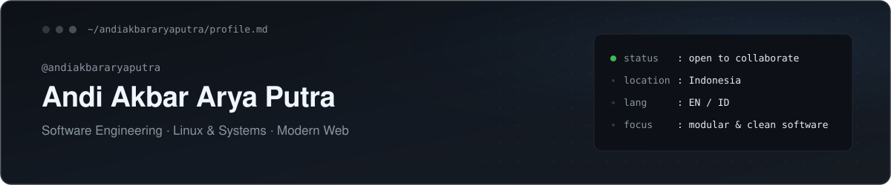

  <!-- 1. Banner Hero SVG Adaptif Tema (Dark / Light) -->
  <picture>
    <source media="(prefers-color-scheme: dark)" srcset="./assets/banner-dark.svg" />
    <source media="(prefers-color-scheme: light)" srcset="./assets/banner-light.svg" />
    
  </picture>

   

  <!-- 2a. Subjudul Animasi Ketik Adaptif Tema -->
  <!-- [EDIT] Ubah baris teks animasi di bawah (+ untuk spasi, %26 untuk &) -->
  <picture>
    <source media="(prefers-color-scheme: dark)" srcset="https://readme-typing-svg.demolab.com?font=JetBrains+Mono&amp;size=15&amp;duration=3000&amp;pause=1000&amp;color=9BA3AF&amp;center=true&amp;vCenter=true&amp;width=680&amp;height=34&amp;lines=Software+Engineer+%26+Kontributor+Open-Source;Linux%2C+Sistem+%26+Pengembangan+Web+Modern;Membangun+Perangkat+Lunak+yang+Bersih+%26+Modular" />
    <source media="(prefers-color-scheme: light)" srcset="https://readme-typing-svg.demolab.com?font=JetBrains+Mono&amp;size=15&amp;duration=3000&amp;pause=1000&amp;color=4B5563&amp;center=true&amp;vCenter=true&amp;width=680&amp;height=34&amp;lines=Software+Engineer+%26+Kontributor+Open-Source;Linux%2C+Sistem+%26+Pengembangan+Web+Modern;Membangun+Perangkat+Lunak+yang+Bersih+%26+Modular" />
    
  </picture>

  <!-- 2b. Navigasi Tautan Minimalis & Pengalih Bahasa -->
  

    <a href="./README.md">🇬🇧 English</a> &nbsp;•&nbsp;
    <strong>🇮🇩 Bahasa Indonesia</strong> &nbsp;•&nbsp;
    <a href="https://andiakbararyaputra.github.io">Web Portofolio</a>
  

  <!-- 2c. Deretan Badge Monokrom Seragam -->
  <!-- [EDIT] Sesuaikan handle LinkedIn dan alamat email Anda -->
  

    
    
    
    
    
  

---

<!-- 3. Kutipan Filosofi & Bio Terstruktur -->
<!-- [EDIT] Sesuaikan kutipan dan poin fokus di bawah dengan aktivitas Anda saat ini -->
> *"Kesederhanaan, modularitas, dan ketelitian — merancang perangkat lunak dan alur kerja yang ringan digunakan sekaligus mudah dirawat."*

- 🔭 **Sedang mengerjakan:** Alat bantu developer yang modular, aplikasi web, serta alur kerja Linux kustom *(lihat [tonal-dots](https://github.com/andiakbararyaputra/tonal-dots))* — `[tambahkan proyek unggulan Anda saat ini]`
- 🌱 **Sedang mendalami:** `[misalnya Sistem Backend Terukur, Full-Stack TypeScript, Cloud-Native Tooling, AI Terapan]`
- 💡 **Fokus utama:** `[misalnya Rekayasa Perangkat Lunak, Kustomisasi Linux & Sistem, Clean Architecture]`
- 📫 **Mari terhubung:** Terbuka untuk peluang magang, posisi *Software Engineer*, dan kolaborasi *open-source* melalui [Email](mailto:your.email@example.com) atau [LinkedIn](https://linkedin.com/in/your-handle).

<!-- Ringkasan Singkat Bahasa Inggris (Inline) -->

  
🇬🇧 <strong>English Profile Summary</strong> <em>(click to expand, or view the <a href="./README.md">full English version</a>)</em>

   

  I'm **Andi Akbar Arya Putra**, a software developer from Indonesia focused on building clean, modular web applications, developer tooling, and customized Linux workflows.

  - 🔭 **Currently working on:** Modular desktop workflows ([tonal-dots](https://github.com/andiakbararyaputra/tonal-dots)) and `[your flagship project]`.
  - 🌱 **Exploring:** `[e.g., Scalable Backend Systems, Full-Stack TypeScript, Cloud Tooling, Applied AI]`.
  - 📫 **Collaboration:** Open to internships, software engineering roles, and open-source work.

  👉 Read the full English profile in **[README.md](./README.md)**.

---

<!-- 4. Proyek Unggulan — Tabel 2 Kolom per Domain -->
### ✦ Proyek Unggulan

| Sistem, Mobile &amp; Perkakas | Web, Full-Stack &amp; AI Terapan |
| :--- | :--- |
| • **[tonal-dots](https://github.com/andiakbararyaputra/tonal-dots)** — Konfigurasi desktop Hyprland 0.57 (Lua) + Noctalia v5 yang modular, dilengkapi tema Material 3, auto-PiP via D-Bus, dan plugin *Desk Clock*. • **[Finara](https://github.com/andiakbararyaputra/Finara)** — Aplikasi Android Flutter untuk alokasi keuangan pribadi berbasis Drift SQLite terenkripsi, DANA+, dan asisten AI. • **[bank-terdistribusi](https://github.com/andiakbararyaputra/bank-terdistribusi)** — Simulasi bank terdistribusi 3 node XML-RPC dengan replikasi state, failover otomatis, dan dashboard Flask. • **[nfa-dfa-toolkit](https://github.com/andiakbararyaputra/nfa-dfa-toolkit)** — Toolkit CLI Java untuk mendefinisikan ε-NFA / DFA serta konversi *subset construction*. | • **[Web Portofolio Cyberpunk](https://andiakbararyaputra.github.io)** — Portofolio interaktif bergaya *Acid-Volt Cyber Brutalism* dengan React 19, TypeScript, GSAP ScrollTrigger &amp; Web Audio ([kode](https://github.com/andiakbararyaputra/andiakbararyaputra.github.io)). • **[INTERVIEW-APP](https://github.com/andiakbararyaputra/INTERVIEW-APP)** — Asisten wawancara *client-side* dengan pencarian MiniSearch &amp; sitasi berkas lokal. • **[Top250](https://github.com/andiakbararyaputra/Top250)** — Katalog film IMDb Top 250 *dark cinematic* memakai Next.js 15, Fastify 5, MongoDB 7 &amp; MinIO. • **[maxres](https://github.com/andiakbararyaputra/maxres)** — Aplikasi *AI image upscaler* 100% offline (Tauri v2) · **[SIFA](https://github.com/Muh-Asad-Habib/sistem_informasi_falak_terintegrasi)** *(Kolaborator)* — Platform PWA ilmu falak terpadu. |

---

<!-- 5. Tech Stack & Ekosistem — Tabel dengan Badge Monokrom Seragam -->
<!-- [EDIT] Sesuaikan daftar badge di bawah dengan teknologi yang Anda kuasai (pertahankan color=313131 agar tetap seragam) -->
### ✦ Tech Stack &amp; Ekosistem

| Kategori | Teknologi |
| :--- | :--- |
| **Bahasa Pemrograman** |      |
| **Web &amp; Aplikasi** |    |
| **Backend, Data &amp; Cloud** |     |
| **Linux, Sistem &amp; Alur Kerja** |      |

---

<!-- 6. Seksi Sekunder dalam Accordion (Progressive Disclosure) -->
<!-- [EDIT] Lengkapi riwayat pendidikan, pengalaman magang/kerja, dan sertifikasi/prestasi Anda -->

  
<strong>💼 Pengalaman, Pendidikan &amp; Pencapaian</strong>

   

  | Periode | Peran / Program | Institusi &amp; Sorotan Utama |
  | :--- | :--- | :--- |
  | `2024 – Sekarang` | **S1 / Teknik Informatika** *(Placeholder)* | `[Nama Universitas]` — Fokus pada rekayasa perangkat lunak, sistem terdistribusi, dan `[mata kuliah/IPK unggulan]`. |
  | `2025` | **Software Engineer Intern / Project Lead** *(Placeholder)* | `[Perusahaan / Tim]` — Membangun `[fitur/sistem]`, meningkatkan `[metrik]` menggunakan `[tech stack]`. |
  | `Pencapaian` | **Sertifikasi &amp; Kompetisi** *(Placeholder)* | `[Tambahkan prestasi hackathon, kontribusi open-source, atau sertifikasi teknologi yang relevan]`. |

  
<strong>⚡ Ringkasan GitHub &amp; Lingkungan Kerja</strong>

   

  - **Lingkungan Utama:** CachyOS (Arch Linux) dengan **Hyprland** (konfigurasi Lua modular) + shell **Noctalia**, **Fish + Starship**, **Kitty / Foot**, dan **Neovim** — terdokumentasi di [tonal-dots](https://github.com/andiakbararyaputra/tonal-dots).
  - **Kebiasaan Rekayasa:** Mengutamakan konfigurasi modular dibanding skrip monolitik, alur instalasi yang dapat direproduksi, dan dokumentasi yang bersih.

  <!-- [EDIT] Kartu statistik pihak ketiga opsional (adaptif Dark/Light via <picture>). Hapus blok ini jika layanan eksternal sedang lambat/tidak tersedia. -->
  

    <picture>
      <source media="(prefers-color-scheme: dark)" srcset="https://github-readme-stats.vercel.app/api?username=andiakbararyaputra&amp;show_icons=true&amp;hide_border=true&amp;bg_color=0d1117&amp;title_color=f0f6fc&amp;text_color=8b949e&amp;icon_color=58a6ff" />
      <source media="(prefers-color-scheme: light)" srcset="https://github-readme-stats.vercel.app/api?username=andiakbararyaputra&amp;show_icons=true&amp;hide_border=true&amp;bg_color=ffffff&amp;title_color=1f2328&amp;text_color=57606a&amp;icon_color=0969da" />
      
    </picture>
  

<!-- 7. Footer Minimalis -->

  
    Terima kasih telah berkunjung — mari berkolaborasi membangun sesuatu yang berdampak. &nbsp;•&nbsp;
    <a href="./README.md">🇬🇧 English Version</a> &nbsp;•&nbsp;
    <a href="https://github.com/andiakbararyaputra">GitHub</a> &nbsp;•&nbsp;
    <a href="mailto:your.email@example.com">Email</a>
  

