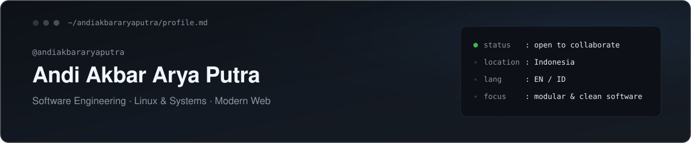

  <!-- 1. Theme-Adaptive Repo-Hosted SVG Hero Card -->
  <picture>
    <source media="(prefers-color-scheme: dark)" srcset="./assets/banner-dark.svg" />
    <source media="(prefers-color-scheme: light)" srcset="./assets/banner-light.svg" />
    
  </picture>

   

  <!-- 2a. Theme-Adaptive Animated Typing Subtitle -->
  <!-- [EDIT] Customize the typing lines below (use + for spaces and %26 for &) -->
  <picture>
    <source media="(prefers-color-scheme: dark)" srcset="https://readme-typing-svg.demolab.com?font=JetBrains+Mono&amp;size=15&amp;duration=3000&amp;pause=1000&amp;color=9BA3AF&amp;center=true&amp;vCenter=true&amp;width=680&amp;height=34&amp;lines=Software+Engineer+%26+Open-Source+Builder;Linux%2C+Systems+%26+Modern+Web+Development;Crafting+Clean%2C+Modular+%26+Reliable+Software" />
    <source media="(prefers-color-scheme: light)" srcset="https://readme-typing-svg.demolab.com?font=JetBrains+Mono&amp;size=15&amp;duration=3000&amp;pause=1000&amp;color=4B5563&amp;center=true&amp;vCenter=true&amp;width=680&amp;height=34&amp;lines=Software+Engineer+%26+Open-Source+Builder;Linux%2C+Systems+%26+Modern+Web+Development;Crafting+Clean%2C+Modular+%26+Reliable+Software" />
    
  </picture>

  <!-- 2b. Minimal Dot-Separated Navigation & Language Switcher -->
  

    <strong>🇬🇧 English</strong> &nbsp;•&nbsp;
    <a href="./README.id.md">🇮🇩 Bahasa Indonesia</a> &nbsp;•&nbsp;
    <a href="https://andiakbararyaputra.github.io">Portfolio Web</a>
  

  <!-- 2c. Cohesive Monochrome Badges Strip -->
  <!-- [EDIT] Replace LinkedIn handle and email address below -->
  

    
    
    
    
    
  

---

<!-- 3. Editorial Philosophy Blockquote & Structured Bio -->
<!-- [EDIT] Personalize your philosophy quote and focus points below -->
> *"Simplicity, modularity, and craftsmanship — building software and workflows that feel effortless to use and remain clear to maintain."*

- 🔭 **Currently working on:** Modular developer tools, web applications, and custom Linux workflows *(see [tonal-dots](https://github.com/andiakbararyaputra/tonal-dots))* — `[add your current flagship project]`
- 🌱 **Exploring:** `[e.g., Scalable Backend Systems, Full-Stack TypeScript, Cloud-Native Tooling, Applied AI]`
- 💡 **Core focus:** `[e.g., Software Engineering, Systems & Linux Customization, Clean Architecture]`
- 📫 **Let's connect:** Open to internships, engineering opportunities, and open-source collaboration via [Email](mailto:your.email@example.com) or [LinkedIn](https://linkedin.com/in/your-handle).

<!-- Inline Collapsible Bahasa Indonesia Summary -->

  
🇮🇩 <strong>Ringkasan Profil dalam Bahasa Indonesia</strong> <em>(klik untuk membuka, atau baca <a href="./README.id.md">versi lengkap</a>)</em>

   

  Saya **Andi Akbar Arya Putra**, seorang pengembang perangkat lunak dari Indonesia yang berfokus membangun aplikasi web modern, sistem yang rapi dan modular, serta lingkungan kerja Linux yang produktif.

  - 🔭 **Sedang dikerjakan:** Pengembangan perangkat lunak modular dan kustomisasi ekosistem Linux ([tonal-dots](https://github.com/andiakbararyaputra/tonal-dots)) — `[tambahkan proyek utama Anda]`.
  - 🌱 **Sedang didalami:** `[misalnya Arsitektur Backend, Full-Stack TypeScript, Cloud & DevOps, atau AI Terapan]`.
  - 📫 **Kolaborasi:** Terbuka untuk peluang magang, posisi *Software Engineer*, dan kontribusi *open-source*.

  👉 Baca portofolio profil selengkapnya dalam Bahasa Indonesia di **[README.id.md](./README.id.md)**.

---

<!-- 4. Featured Projects — 2-Column Category Table -->
### ✦ Featured Projects

| Systems, Mobile &amp; Tooling | Web, Full-Stack &amp; Applied AI |
| :--- | :--- |
| • **[tonal-dots](https://github.com/andiakbararyaputra/tonal-dots)** — Modular Lua Hyprland 0.57 + Noctalia v5 desktop environment with Material 3 wallpaper-driven colors, smart D-Bus auto-PiP, and custom Desk Clock plugin. • **[Finara](https://github.com/andiakbararyaputra/Finara)** — Flutter Android personal finance allocation app with encrypted Drift SQLite, Bibit/Stockbit/DANA+ tracking, and AI assistant. • **[bank-terdistribusi](https://github.com/andiakbararyaputra/bank-terdistribusi)** — 3-node XML-RPC distributed bank simulation with peer replication, failover, and Flask live topology dashboard. • **[nfa-dfa-toolkit](https://github.com/andiakbararyaputra/nfa-dfa-toolkit)** — Java CLI toolkit for ε-NFA / DFA definition and step-by-step subset construction. | • **[Cyberpunk Portfolio](https://andiakbararyaputra.github.io)** — Interactive Acid-Volt Cyber-Brutalist portfolio built with React 19, TypeScript, GSAP ScrollTrigger &amp; Web Audio ([source](https://github.com/andiakbararyaputra/andiakbararyaputra.github.io)). • **[INTERVIEW-APP](https://github.com/andiakbararyaputra/INTERVIEW-APP)** — Client-side Grounded Interview Assistant with MiniSearch retrieval and strict file citations. • **[Top250](https://github.com/andiakbararyaputra/Top250)** — Dark cinematic IMDb Top 250 explorer built with Next.js 15, Fastify 5, MongoDB 7, and MinIO. • **[maxres](https://github.com/andiakbararyaputra/maxres)** — 100% offline Tauri v2 AI image upscaler (2x–16x) · **[SIFA](https://github.com/Muh-Asad-Habib/sistem_informasi_falak_terintegrasi)** *(Collaborator)* — Offline-first Islamic astronomy PWA. |

---

<!-- 5. Tech Stack & Ecosystem — Uniform Monochrome Badges -->
<!-- [EDIT] Customize badges below to match your real stack (keep color=313131 for visual consistency) -->
### ✦ Tech Stack &amp; Ecosystem

| Category | Stack |
| :--- | :--- |
| **Languages** |      |
| **Web &amp; Application** |    |
| **Backend, Data &amp; Cloud** |     |
| **Linux, Systems &amp; Workflow** |      |

---

<!-- 6. Progressive Disclosure Secondary Accordions -->
<!-- [EDIT] Fill in your real education, experience, and certifications/awards -->

  
<strong>💼 Experience, Education &amp; Milestones</strong>

   

  | Period | Role / Program | Organization &amp; Key Highlights |
  | :--- | :--- | :--- |
  | `2024 – Present` | **B.S. / Informatics Engineering** *(Placeholder)* | `[University Name]` — Focus on software engineering, distributed systems, and `[key coursework/GPA]`. |
  | `2025` | **Software Engineer Intern / Project Lead** *(Placeholder)* | `[Company / Team]` — Built `[feature/system]`, improving `[metric]` using `[tech stack]`. |
  | `Milestone` | **Certifications &amp; Competitions** *(Placeholder)* | `[Add notable hackathon placements, open-source contributions, or cloud/dev certifications]`. |

  
<strong>⚡ GitHub Snapshot &amp; Daily Environment</strong>

   

  - **Daily Driver:** CachyOS (Arch Linux) running modular Lua **Hyprland** + **Noctalia** shell, **Fish + Starship**, **Kitty / Foot**, and **Neovim** — documented in [tonal-dots](https://github.com/andiakbararyaputra/tonal-dots).
  - **Engineering Habits:** Modular configuration over monolithic scripts, reproducible setup flows, and clean documentation.

  <!-- [EDIT] Optional third-party stats card (theme-adaptive via <picture>). Remove this block if github-readme-stats is slow or unavailable. -->
  

    <picture>
      <source media="(prefers-color-scheme: dark)" srcset="https://github-readme-stats.vercel.app/api?username=andiakbararyaputra&amp;show_icons=true&amp;hide_border=true&amp;bg_color=0d1117&amp;title_color=f0f6fc&amp;text_color=8b949e&amp;icon_color=58a6ff" />
      <source media="(prefers-color-scheme: light)" srcset="https://github-readme-stats.vercel.app/api?username=andiakbararyaputra&amp;show_icons=true&amp;hide_border=true&amp;bg_color=ffffff&amp;title_color=1f2328&amp;text_color=57606a&amp;icon_color=0969da" />
      
    </picture>
  

<!-- 7. Minimalist Editorial Footer -->

  
    Thanks for visiting — let's build something thoughtful together. &nbsp;•&nbsp;
    <a href="./README.id.md">🇮🇩 Versi Bahasa Indonesia</a> &nbsp;•&nbsp;
    <a href="https://github.com/andiakbararyaputra">GitHub</a> &nbsp;•&nbsp;
    <a href="mailto:your.email@example.com">Email</a>
  

